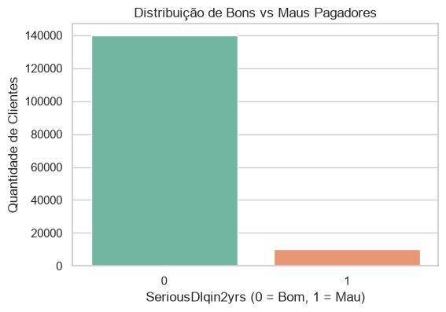
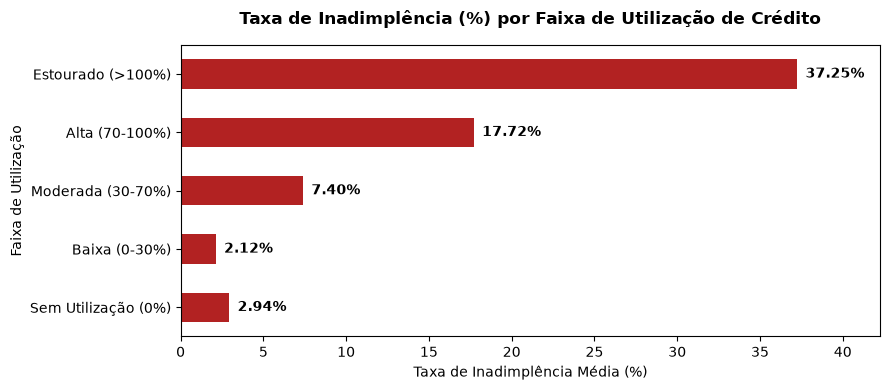
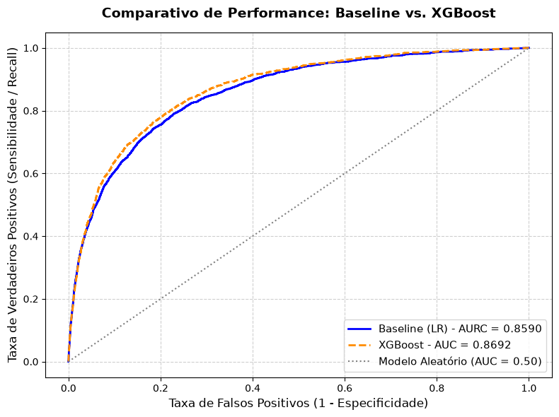
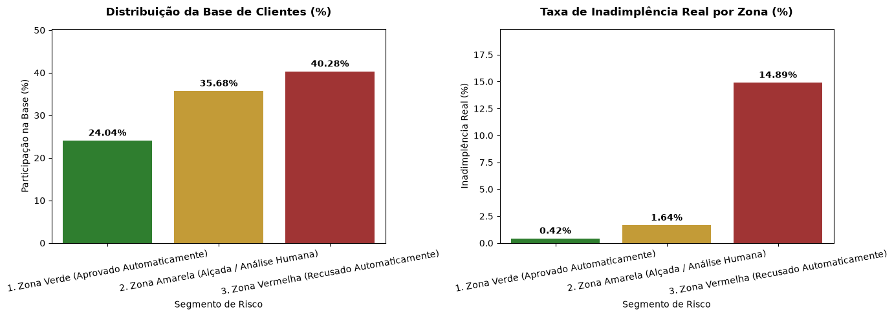
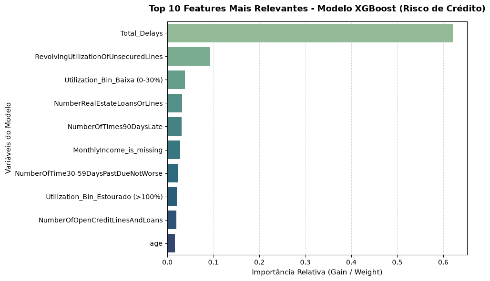

# Credit Scoring & Risk Analytics Pipeline

Pipeline end-to-end de desenvolvimento de modelos de risco de crédito e *credit scorecard*, construído com rigor estatístico, engenharia de dados modular, foco em tomada de decisão executiva e boas práticas de MLOps.

---

## Visão Geral do Projeto

Este projeto simula um ambiente corporativo real de modelagem de risco em instituições financeiras, tendo como objetivo prever a probabilidade de inadimplência de clientes (`SeriousDlqin2yrs`) utilizando o clássico dataset *Give Me Some Credit*. O pipeline foi estruturado em quatro grandes frentes:
1. **Fase 1 (Ingestão e EDA):** Carga relacional em banco SQLite, otimização via Parquet, auditoria de dados e análise exploratória do desbalanceamento da carteira.
2. **Fase 2 (Feature Engineering):** Criação de variáveis comportamentais e de domínio críticas para o setor de crédito.
3. **Fase 3 (Modelagem e Métricas de Risco):** Comparação entre um Baseline tradicional (Regressão Logística) e um Ensemble avançado (XGBoost), avaliados por ROC-AUC e Estatística KS.
4. **Fase 4 (Políticas de Crédito e MLOps):** Tradução de probabilidades em regras de negócio acionáveis (*cut-offs*) e serialização dos artefatos.

--- 

## Tecnologias e Ferramentas Utilizadas

- **Python 3.x** (Linguagem principal)
- **SQLite & SQL** (Armazenamento relacional e estruturação do pipeline de dados)
- **Pandas & NumPy** (Manipulação, limpeza e transformação estrutural de dados)
- **Scikit-Learn** (Métricas de avaliação, pré-processamento, Padronização e Regressão Logística)
- **XGBoost** (Algoritmo de *Ensemble* baseado em árvores para captura de não-linearidades - Modelo Campeão)
- **Matplotlib & Seaborn** (Visualizações analíticas e construção de relatórios executivos)
- **PyArrow** (Persistência e leitura otimizada de dados em formato Parquet)
- **Joblib** (Serialização e persistência de artefatos de modelos treinados para produção / MLOps)

--- 

## Fase 1: Ingestão, EDA e Tratamento de Dados

Na primeira etapa, os dados brutos foram ingeridos em um banco de dados relacional **SQLite**, estruturados com consultas e convertidos para o formato otimizado **Parquet**. Na Análise Exploratória (EDA), mapeamos o comportamento da carteira:
- **Desbalanceamento Crítico:** A base possui apenas **6,68% de inadimplência** (maus pagadores), exigindo técnicas de tratamento de classe e métricas focadas em sensibilidade (*Recall* e *KS*).
- **Tratamento de Missing:** Imputação em variáveis como renda mensal (`MonthlyIncome`), acompanhada da criação de flags binárias indicando a ausência do dado.

### Distribuição da Carteira (Bons vs. Maus Pagadores)


---

## Fase 2: Engenharia de Recursos (*Feature Engineering*)

Para elevar o poder preditivo do modelo, foram criadas variáveis de domínio baseadas no comportamento financeiro do tomador:
1. **`EstimateDebt`**: Volume absoluto de dívida estimado a partir da renda e do comprometimento.
2. **`Utilization_Bin`**: Discretização do saldo rotativo em faixas de risco (de *Sem Utilização* até *Estourado >100%*).
3. **`Total_Delays` & `Has_History_Delays`**: Agregação de reincidência de atrasos e flag binária de histórico de adimplência.

### Taxa de Inadimplência por Faixa de Utilização de Crédito


---

## Fase 3: Modelagem Preditiva e Métricas de Risco

O projeto compara um modelo tradicional de mercado (*Baseline*) com um algoritmo de *ensemble* avançado:
- **Baseline (Regressão Logística / Scorecard Tradicional):** Garantia de interpretabilidade regulatória e transparência de coeficientes. (**ROC-AUC:** `0.8590` | **Estatística KS:** `56,18%`)
- **Modelo Campeão (XGBoost com `scale_pos_weight`):** Captura de não-linearidades e interações complexas. (**ROC-AUC:** `0.8692` | **Estatística KS:** `58,02%`)

### Curva ROC Comparativa e Estatística KS 


---

## Fase 4: Políticas de Crédito (*cut-offs*) e Interpretabilidade

O modelo foi traduzido em regras de negócio acionáveis para o comitê de crédito da instituição através de faixas de probabilidade:
- **Zona Verde (< 10% de risco):** Aprovação automática (24% da base, com inadimplência residual de apenas **0.42%**).
- **Zona Amarela (10% a 30% de risco):** Alçada de crédito / Análise humana (35% da base, com **1.64%** de calote).
- **Zona Vermelha (> 30% de risco):** Recusa automática (Bloqueio preventivo de clientes com **14.89%** de inadimplência real, blindando o capital).



### Interpretabilidade (Feature Importance)
O ranking de importância do XGBoost provou que a feature agregada `Total_Delays` responde por mais de 60% do ganho de informação do modelo:



---

## Como Executar o Projeto
Clone o repositório para o seu ambiente local:
```bash
git clone https://github.com/m-mnzs/projeto-credit-scoring.git
```

Crie e ative um ambiente virtual:
```bash
python -m venv .venv
source .venv/bin/activate # No Windows: .venv\Scripts\activate
```

Instale as dependências necessárias:
```bash
pip install pandas numpy scikit-learn xgboost matplotlib seaborn pyarrow joblib
```

Execute os notebooks em ordem sequencial (de 01 a 04) na pasta notebooks/ para reproduzir todo o pipeline de dados, engenharia de recursos, modelagem preditiva e exportação dos artefatos.

---

## Estrutura do Repositório
```text
projeto-credit-scoring/
├── data/
│   ├── credit_scoring.db          # Banco de dados SQLite relacional
│   ├── credito_processado.parquet # Base otimizada pós-feature engineering
│   └── cs-training.csv / cs-test.csv # Dados originais brutos
├── models/
│   ├── lr_baseline_model.pkl      # Modelo Baseline serializado (Joblib)
│   └── xgb_credit_scoring_model.pkl # Modelo Campeão XGBoost serializado (Joblib)
├── notebooks/
│   ├── 01_ingestao_e_etl.py       # Ingestão e pipeline inicial em SQLite
│   ├── 02_eda_e_tratamento.ipynb  # Análise Exploratória e Tratamento de Missing
│   ├── 03_feature_engineering.ipynb # Criação de variáveis de domínio
│   └── 04_modelagem_e_scorecard.ipynb # Modelagem, métricas de risco e políticas
└── output/
    └── *.png                      # Gráficos analíticos e executivos gerados