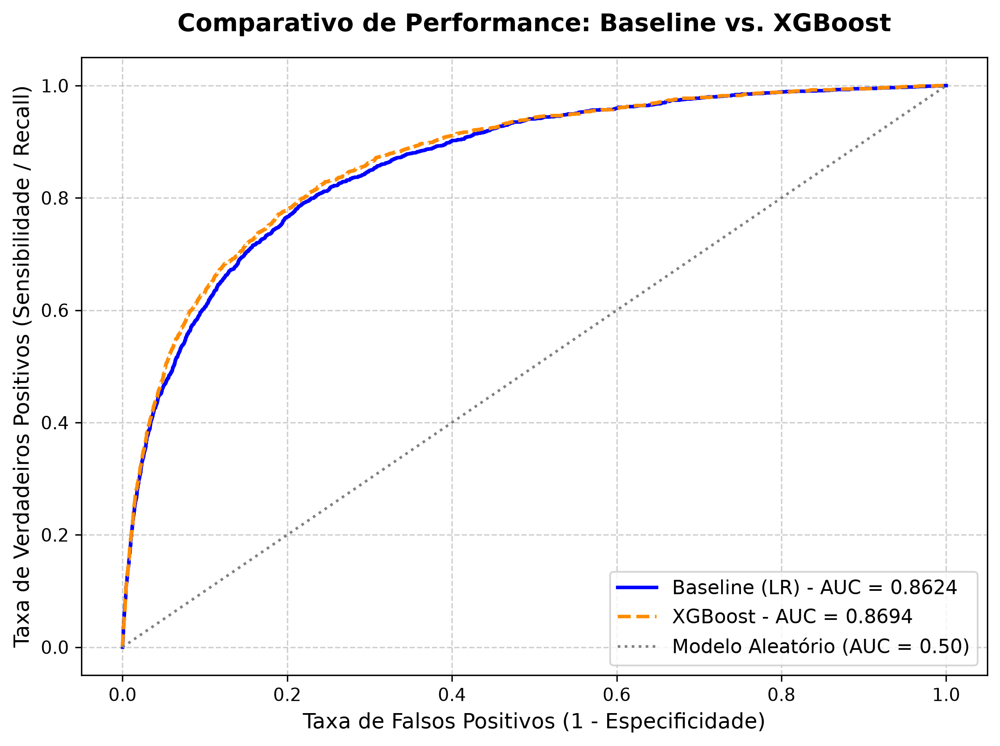
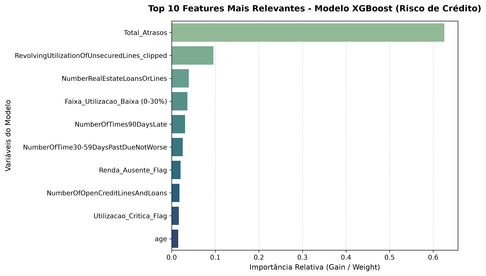
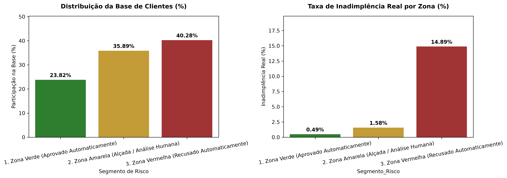

# Credit Scoring & Risk Analytics Pipeline

Pipeline *end-to-end* de desenvolvimento de modelos de risco de crédito e *scorecard*, construído com rigor estatístico, engenharia de dados modular, foco em tomada de decisão executiva e boas práticas de MLOps.

---

## Visão Geral do Projeto

Este projeto simula um ambiente corporativo real de modelagem de risco em instituições financeiras, utilizando o clássico dataset *Give Me Some Credit*, disponível no [Kaggle](https://www.kaggle.com/competitions/GiveMeSomeCredit) para prever a probabilidade de inadimplência (`SeriousDlqin2yrs`). O pipeline está estruturado em quatro etapas:

1. **Fase 1 (Ingestão e EDA):** Carga relacional em banco SQLite, auditoria de dados e análise exploratória do desbalanceamento da carteira.
2. **Fase 2 (Feature Engineering):** Criação de variáveis comportamentais críticas para o setor (ex: faixas de utilização, flags e agregação de atrasos).
3. **Fase 3 (Modelagem e Métricas de Risco):** Comparação entre um Baseline tradicional regulatório (Regressão Logística com *StandardScaler* e *SimpleImputer*) e um *Ensemble* avançado (XGBoost), validados por ROC-AUC e Estatística KS.
4. **Fase 4 (Políticas de Crédito e MLOps):** Tradução de probabilidades em regras de negócio acionáveis (*cut-offs* de Zonas de Risco) e serialização dos artefatos para produção.

---

## Tecnologias e Ferramentas Utilizadas

* **Python 3.x**
* **SQLite & SQL** (Banco de dados relacional e persistência)
* **Pandas & NumPy** (Manipulação e transformação de dados)
* **Scikit-Learn** (Pré-processamento, *Pipeline*, *StandardScaler*, *SimpleImputer* e Regressão Logística)
* **XGBoost** (Modelo campeão baseado em árvores para captura de não-linearidades)
* **Matplotlib & Seaborn** (Visualizações analíticas e relatórios executivos)
* **PyArrow & Joblib** (Persistência otimizada e serialização de artefatos)

---

## Principais Resultados e Métricas

| Modelo | ROC-AUC | Estatística KS | Principais Vantagens |
| :--- | :---: | :---: | :--- |
| **Baseline (Regressão Logística)** | `0.8624` | `57.16%` | Interpretabilidade regulatória (*Scorecard* tradicional) |
| **Modelo Campeão (XGBoost)** | **`0.8694`** | **`58.36%`** | Poder preditivo superior e captura de interações complexas |



* **Feature Importance:** Com a remoção de colunas redundantes, o XGBoost concentrou **62.5%** da importância preditiva na variável agregada de histórico de reincidência de atrasos (`Total_Atrasos`), validando a premissa fundamental de risco de crédito.


* **Política de Crédito por Zonas:**
  * **Zona Verde (< 10% de risco):** Aprovação automática (23.82% da base, com inadimplência residual de apenas **0.49%**).
  * **Zona Amarela (10% a 30% de risco):** Alçada de crédito / Análise humana (35.89% da base, com **1.58%** de calote).
  * **Zona Vermelha (> 30% de risco):** Recusa automática (Bloqueio preventivo de clientes com **14.89%** de inadimplência real, blindando o capital).


---
Estrutura do Repositório:

```txt
projeto-credit-scoring/
├── data/
│   ├── credit_scoring.db              # Banco de dados SQLite relacional
│   └── cs-training.csv / cs-test.csv  # Dados brutos originais
├── models/
│   ├── baseline_regressao_logistica.pkl # Modelo Baseline serializado (Joblib)
│   └── xgboost.pkl                      # Modelo Campeão XGBoost serializado (Joblib)
├── notebooks/
│   ├── 02_eda_e_tratamento.ipynb      # Análise Exploratória e Tratamento de Missing
│   ├── 03_feature_engineering.ipynb   # Criação de variáveis de domínio
│   └── 04_modelagem_e_scorecard.ipynb # Modelagem, métricas de risco e políticas
├── src/                     # Scripts de ingestão e pipeline em .py
│   └── 01_ingestao_e_etl.py           # Ingestão e pipeline inicial em SQLite
├── output/
│   └── *.png                          # Gráficos analíticos e executivos gerados
├── requirements.txt                   # Dependências do projeto
└── README.md                          # Documentação principal
```

---

## Como Executar o Projeto

Clone o repositório para o seu ambiente local:

```bash
git clone https://github.com/m-mnzs/projeto-credit-scoring.git
cd projeto-credit-scoring
```

Crie e Ative um ambiente virtual:

```bash
python -m venv .venv
source .venv/bin/activate  # No Windows: .venv\Scripts\activate
```

Instale as dependências utilizando o arquivo de configuração:

```bash
pip install -r requirements.txt
```

Execute o script na pasta src/ e os notebooks na pasta notebooks/ seguindo a numeração sequencial para reproduzir a ingestão, a EDA e a modelagem preditiva.
